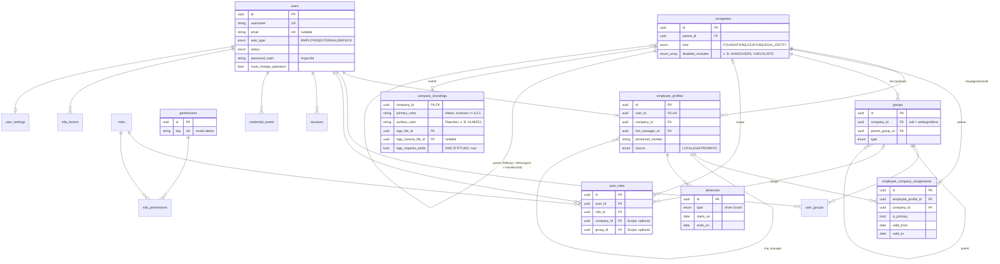
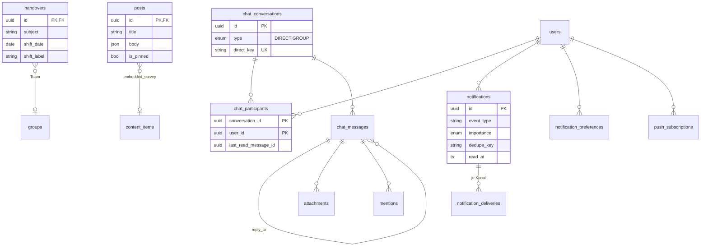
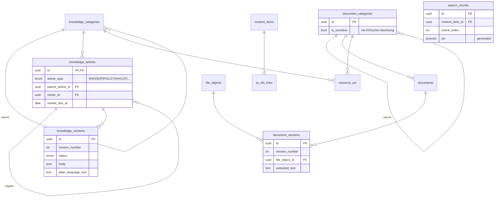
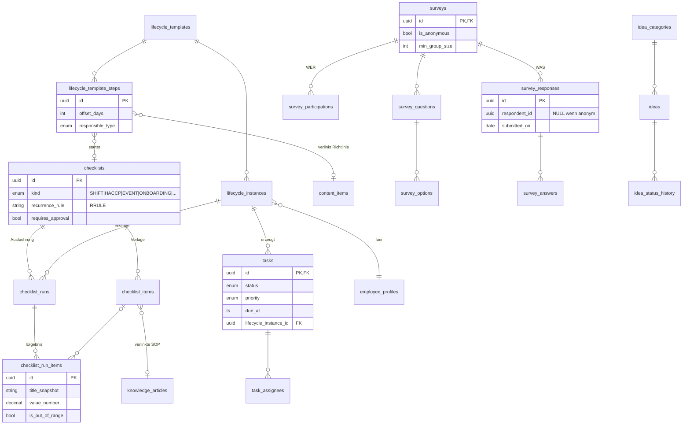
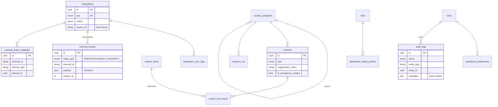

# ER-Modell

Stand: 05.10.2026 · 77 Tabellen · maßgeblich ist `prisma/schema.prisma`; ergänzende Constraints in `prisma/sql/0001_constraints_draft.sql`.
Die Diagramme zeigen je Domäne Schlüssel und fachlich wichtige Attribute; Zeitstempel (`created_at`, `updated_at`) sind weggelassen.

## Abgleich Spec §5 → Schema

| Spec-Tabelle | Im Schema | Anmerkung |
|---|---|---|
| companies, users, employee_profiles, groups, roles, permissions, role_permissions, user_roles | ✔ gleichnamig | `user_roles` mit optionalem Scope (Gesellschaft/Gruppe) |
| user_groups | ✔ `user_groups` | Mitgliedschaft am **User** statt am Profil (ADR-006) |
| posts, comments, reactions, chat_* , handovers, notifications, notification_preferences | ✔ | Kommentare/Reaktionen generisch über `content_items` |
| post_targets, handover_targets | → `content_audiences` | generischer Verteiler (§19/§21) |
| post_reads, handover_reads | → `read_receipts` | generischer Lesestatus (§21) |
| knowledge_categories, knowledge_articles, knowledge_versions | ✔ | Kapitel = Artikel mit `parent_article_id` |
| knowledge_permissions, document_permissions | → `resource_acl` | ein ACL-Modell für Kategorien und Objekte |
| documents, document_versions, document_categories | ✔ | |
| tasks, task_assignees, checklists, checklist_items, checklist_runs | ✔ | + `checklist_run_items` (Ergebnis je Punkt, fehlte in Spec) |
| surveys, survey_options, survey_responses | ✔ | + `survey_questions`, `survey_answers`, `survey_participations` (Anonymität, ADR-013) |
| ideas, idea_categories, idea_status_history | ✔ | |
| idea_comments | → `comments` | §19: keine Parallelmodelle |
| absences | ✔ | ohne Abwesenheitsgrund |
| employee_settings | → `user_settings` | auch externe Accounts haben Einstellungen |
| contacts, contact_categories, contact_documents | ✔ | `contact_documents` verweist auf Dokumente-Modul |
| integrations, integration_sync_logs, external_entities, external_entity_mappings | ✔ | |
| audit_logs | ✔ | append-only |
| **§18** onboarding_templates / offboarding_templates | → `lifecycle_templates` (kind) | ein Modell für beide |
| onboarding_steps | → `lifecycle_template_steps` | erzeugen Tasks/Checklisten-Läufe |
| onboarding_instances | → `lifecycle_instances` | |
| dashboard_preferences | ✔ + `dashboard_widget_policies` | Admin-Grenzen je Rolle |
| survey_results | ✘ keine Tabelle | Aggregation per Query/View mit Mindestgruppengröße |
| content_translations | ✔ | |
| content_media | → `attachments` + `file_objects` | `kind` = IMAGE/VIDEO/… |
| qr_nfc_links | ✔ (optional) | |
| companies 1:n Mitarbeiter (§4) | ✔ + `employee_company_assignments` | Mitarbeitende in mehreren Gesellschaften (ADR-020) |
| Social Feed (§16) | `posts.kind = SOCIAL` + `content_reports` | kein zweites Feed-Modell (ADR-031) |
| Stiftungsgruppe (Ausbaustufe 2) | `companies.parent_id/kind` + `company_brandings` | ADR-034 |
| Auftritt je Gesellschaft, Module je Gesellschaft | `company_brandings.surface_color/logo_requires_white`, `companies.disabled_modules` (Enum `AppModule`) | ADR-039 |
| Open API (ADR-035) | `api_clients`, `webhook_subscriptions`; `integrations.key` frei | neue Systeme ohne Schemaänderung |
| **neu, nicht in Spec** | `content_items`, `content_recipients`, `reminders`, `mentions`, `file_objects`, `notification_deliveries`, `push_subscriptions`, `sessions`, `credential_resets`, `mfa_factors`, `search_chunks`, `system_settings` | technisch notwendig für Spec-Anforderungen |

---

## 1. Organisation & Identity

## 2. Content-Registry & Querschnitt

```mermaid
erDiagram
  content_items ||--o| posts : "1:1 shared PK"
  content_items ||--o| handovers : "1:1"
  content_items ||--o| knowledge_articles : "1:1"
  content_items ||--o| documents : "1:1"
  content_items ||--o| surveys : "1:1"
  content_items ||--o| tasks : "1:1"
  content_items ||--o| checklist_runs : "1:1"
  content_items ||--o| ideas : "1:1"
  content_items ||--o{ content_audiences : Verteiler
  content_items ||--o{ content_recipients : "Empfaenger-Snapshot"
  content_items ||--o{ resource_acl : "Objekt-ACL"
  content_items ||--o{ read_receipts : ""
  content_items ||--o{ reminders : ""
  content_items ||--o{ comments : ""
  content_items ||--o{ reactions : ""
  content_items ||--o{ mentions : ""
  content_items ||--o{ attachments : ""
  content_items ||--o{ search_chunks : ""
  content_items ||--o{ notifications : ""
  comments ||--o{ comments : replies
  comments ||--o{ reactions : ""
  comments ||--o{ attachments : ""
  file_objects ||--o{ attachments : ""
  users ||--o{ read_receipts : ""
  users ||--o{ content_recipients : ""

  content_items { uuid id PK
    enum type
    uuid company_id FK
    uuid author_id FK
    enum status
    enum importance
    int current_version
    bool read_tracking_enabled
    bool requires_acknowledgement
    int auto_remind_after_hours
    int max_reminders }
  content_audiences { uuid id PK
    enum target_type "ALL|COMPANY|GROUP|ROLE|USER"
    bool include_late_joiners }
  content_recipients { uuid content_item_id PK
    uuid user_id PK
    enum reason
    ts removed_at }
  read_receipts { uuid id PK
    ts first_seen_at
    ts opened_at
    ts acknowledged_at
    int acknowledged_version }
  reminders { uuid id PK
    uuid recipient_id FK
    enum trigger "MANUAL|AUTOMATIC"
    enum channel
    int sequence_no
    enum status }
  resource_acl { uuid id PK
    uuid content_item_id FK "genau eines"
    uuid knowledge_category_id FK
    uuid document_category_id FK
    uuid contact_category_id FK
    enum principal_type
    enum_array actions }
  content_translations { uuid id PK
    enum entity_type "polymorph"
    uuid entity_id
    string target_locale
    string source_hash }
```

## 3. Kommunikation & Benachrichtigungen

## 4. Wissen, Dokumente, Suche

## 5. Zusammenarbeit (Aufgaben, Checklisten, On-/Offboarding, Umfragen, Ideen)

## 6. Kontakte, Integrationen, System

## Lösch- und Integritätsregeln (Auszug)

| Beziehung | onDelete | Grund |
|---|---|---|
| users → employee_profiles | Restrict | User werden deaktiviert, nicht gelöscht; Löschung nur über DSGVO-Löschprozess |
| content_items → Subtypen, Lesestatus, Kommentare … | Cascade | Inhalt endgültig gelöscht ⇒ Nebendaten weg |
| Autor-/Akteur-Referenzen | SetNull | Inhalte überleben gelöschte Accounts ("ehemalige/r Mitarbeitende/r") |
| file_objects ← attachments / document_versions | Restrict | Datei erst löschen, wenn nichts mehr verweist (Cleanup-Job) |
| Kategorien → Kinder/Inhalte | Restrict | Kein versehentliches Massenlöschen |
